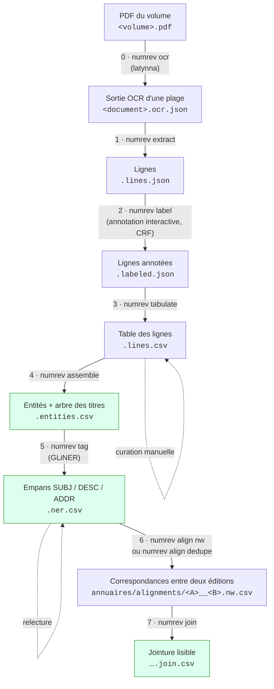

# Numérotation révolutionnaire

Chaîne de traitement qui transforme des annuaires parisiens numérisés du
début du XIXᵉ siècle en données structurées :

1. des **entrées** (une personne, une maison de commerce) rangées sous les
   **titres** de l'annuaire (parties, rubriques) : un humain classe les
   lignes lues par l'OCR, aidé d'un modèle qui apprend de ses réponses (CRF) ;
2. chaque entrée **découpée** en sujet `SUBJ` (qui ?), description `DESC`
   (quoi ?) et adresse `ADDR` (où ?) par un modèle de reconnaissance
   d'entités (GLiNER), qui signale les entrées à relire en priorité ;
3. les **correspondances** entre les entrées de deux éditions d'un annuaire,
   trouvées rubrique par rubrique en suivant l'ordre des listes (ou par
   Dedupe), avec pour chaque paire une incertitude (faible, moyenne, forte)
   qui oriente la relecture humaine.

Pour traiter un annuaire, commencer par
[`docs/guide_traitement.md`](docs/guide_traitement.md) ; pour utiliser les
données produites, lire [`docs/donnees.md`](docs/donnees.md).

## Prérequis

- Python 3.12 ou plus récent
- [uv](https://docs.astral.sh/uv/)
- Le PDF complet de chaque annuaire, rangé en `annuaires/<volume>/<volume>.pdf`.
- Pour l'OCR (étape 0) : le paquet `latynna` (projet voisin
  `../finetuning_chandra_for_directories`, `uv sync --group ocr`) et une
  machine GPU qui sert le modèle latynna-v4 avec vLLM.

## Installation

```bash
uv sync            # installe les dépendances et la commande `numrev`
uv run numrev      # liste des commandes
```

## Vue d'ensemble

Tout passe par une seule commande, `numrev`. Les étapes 0 à 5 traitent une
**plage de pages** d'un volume (un *document*), les étapes 6 et 7 une
**paire d'annuaires** complets. Chaque étape ajoute son suffixe au nom du
document :



Les corrections humaines des lignes (classes, texte) et des empans NER se
font directement dans les CSV produits, en marquant `corrige = oui` ; chaque
commande les capture dans un patch versionné (`data/curation/`) et les
réapplique quand on la relance. Les décisions sur les correspondances
s'écrivent dans les patchs de `data/alignment/`, à l'aide du viewer
d'alignement. Toute commande s'arrête sans rien écrire si une correction ne
s'applique plus (voir [`docs/guide_curation.md`](docs/guide_curation.md)).

## Commandes

Toutes les commandes se lancent depuis la racine du dépôt. Celles qui
écrivent des fichiers de données **simulent par défaut** (elles affichent ce
qu'elles écriraient) : `--apply` écrit. `uv run numrev <commande> --help`
détaille les options : l'essentiel d'abord, puis les « Réglages fins ».

```bash
# Où en est-on ? (par plage : étapes faites, absentes ou périmées, et la commande suivante)
uv run numrev status

# Étapes 0 à 5 : sur une plage (annuaires/<volume>/<première>-<dernière page>)
# ou sur un volume entier (annuaires/<volume>, toutes ses plages)
uv run numrev ocr      annuaires/1808_AD75-PER292/7-186 --apply   # OCR latynna (serveur vLLM lancé)
uv run numrev extract  annuaires/1808_AD75-PER292 --apply         # lignes
uv run numrev label    annuaires/1808_AD75-PER292/7-186           # annotation interactive, une plage
uv run numrev tabulate annuaires/1808_AD75-PER292 --apply         # table des lignes, à corriger à la main
uv run numrev assemble annuaires/1808_AD75-PER292 --apply         # entités et arbre des titres
uv run numrev tag      annuaires/1808_AD75-PER292 --apply         # empans NER, à relire

# Étapes 6 et 7, sur une paire d'annuaires complets
uv run numrev align nw annuaires/<A> annuaires/<B> --apply       # alignement ordonné, sans apprentissage
uv run numrev align dedupe annuaires/<A> annuaires/<B> --apply   # alternative : Dedupe (+ patch manuel)
uv run numrev join annuaires/alignments/<A>__<B>.nw.csv --excel --apply   # jointure CSV pour les historiens

# Consultation
uv run numrev view directory     # un annuaire, empans et entrées suspectes
uv run numrev view alignment     # un alignement, aide à la relecture
uv run numrev view ocr annuaires/<volume>/<plage>   # l'OCR d'une plage posé sur le PDF

# Modèles et évaluation
uv run numrev gold ner --apply                    # tire le gold NER (une fois)
uv run numrev train-set --apply                   # jeu d'entraînement NER → data/ner/train.ls.json
uv run numrev train data/ner/train.ls.json --apply   # entraîne GLiNER (machine GPU)
uv run numrev audit ner --split dev --model models/ner.gliner-model   # → reports/ner/
uv run numrev audit crf                           # CRF de l'étape 2 → reports/crf/
uv run numrev gold alignment annuaires/<A> annuaires/<B> --apply   # gold d'inversions à étiqueter (une fois)
uv run numrev audit alignment data/alignment/<A>__<B>.gold-inversions.csv   # → reports/alignment/

# Tests (unittest) et mise en forme du code
uv run python -m unittest discover -s tests
uv run black src tests && uv run ruff check src tests
```

## Documentation

**Traiter un annuaire**

- [`docs/guide_traitement.md`](docs/guide_traitement.md) — **par où
  commencer** : le parcours d'un annuaire, du PDF aux données, et ce que
  fait l'humain à chaque étape ;
- [`docs/guide_curation.md`](docs/guide_curation.md) — corriger les lignes,
  le NER et l'alignement à la main sans perdre ses corrections quand on
  relance la chaîne (exemples, messages d'arrêt) ;
- [`docs/guide_annotation_lignes.md`](docs/guide_annotation_lignes.md) —
  classes des lignes et niveaux de titres (étapes 2 et 3) ;
- [`docs/guide_annotation_ner.md`](docs/guide_annotation_ner.md) —
  conventions d'annotation des empans `SUBJ` / `DESC` / `ADDR` ;
- [`docs/guide_relecture_alignement.md`](docs/guide_relecture_alignement.md) —
  conventions de relecture des correspondances (motifs, réponses OUI / NON /
  INCERTAIN, patch).

**Utiliser les données**

- [`docs/donnees.md`](docs/donnees.md) — l'annuaire structuré et la jointure
  de deux éditions, colonne par colonne, et leurs limites.

**Comprendre et faire évoluer la chaîne**

- [`docs/pipeline.md`](docs/pipeline.md) — documentation technique :
  organisation des fichiers, chaque étape (entrées, sorties, options,
  schémas), audits, formats et code ;
- [`docs/alignement_ordonne.md`](docs/alignement_ordonne.md) — méthode de
  l'alignement ordonné (Needleman-Wunsch + pair-HMM) et son évaluation sur
  un gold d'inversions ;
- [`docs/experience_gliner_relex.md`](docs/experience_gliner_relex.md) —
  essai d'un modèle GLiNER-relex pour la NER.

## Organisation du dépôt

| Chemin | Contenu |
|---|---|
| `src/numrev/cli.py` | Point d'entrée `numrev` : la liste des commandes |
| `src/numrev/pipeline/` | Une commande par étape (0 à 7) |
| `src/numrev/viewers/` | Viewers (`numrev view`) : Streamlit pour `directory` et `alignment` ; `ocr.html`, page autonome qui pose une sortie OCR sur son PDF |
| `src/numrev/devtools/` | Gold, jeu d'entraînement, entraînement, audits |
| `src/numrev/crf/`, `ner/`, `alignment/` | Code partagé de chaque domaine |
| `src/numrev/paths.py` | Noms et emplacements des fichiers |
| `src/numrev/curation.py` | Protocole des corrections humaines rejouables |
| `tests/` | Tests unitaires |
| `docs/` | Documentation |
| `data/curation/` | Patchs des corrections humaines (lignes, NER) |
| `data/alignment/` | Paires étiquetées pour Dedupe, patchs d'alignement, gold des inversions |
| `data/ner/` | Gold d'évaluation et jeu d'entraînement NER (Label Studio) |
| `explorations/` | Notebooks exploratoires |
| `annuaires/` | Dossiers de travail par volume et sorties d'alignement (hors git) |
| `models/` | Modèles GLiNER entraînés (hors git) ; `models/ner.gliner-model` = modèle de production |
| `reports/` | Rapports d'audit |
