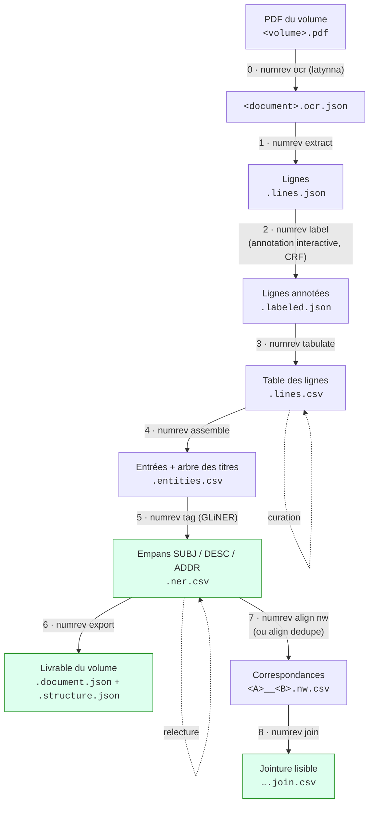

# Numérotation révolutionnaire

Chaîne de traitement qui transforme des annuaires parisiens numérisés du
début du XIXᵉ siècle en données structurées :

1. des **entrées** (une personne, une maison de commerce) rangées sous les
   **titres** de l'annuaire : un humain classe les lignes lues par l'OCR,
   aidé d'un modèle qui apprend de ses réponses (CRF) ;
2. chaque entrée **découpée** en sujet `SUBJ` (qui ?), description `DESC`
   (quoi ?) et adresse `ADDR` (où ?) par un modèle de reconnaissance
   d'entités (GLiNER), qui signale les entrées à relire ;
3. le **livrable d'un volume** : deux fichiers JSON, le document (pages,
   lignes, leur place sur la page) et sa structure (titres, entrées, empans),
   chaque information reliée aux lignes dont elle vient ;
4. les **correspondances** entre les entrées de deux éditions, rubrique par
   rubrique, avec une incertitude (faible, moyenne, forte) qui oriente la
   relecture.

Pour traiter un annuaire : [`docs/guide_traitement.md`](docs/guide_traitement.md).
Pour utiliser les données : [`docs/donnees.md`](docs/donnees.md).

## Installation

Prérequis : Python ≥ 3.12, [uv](https://docs.astral.sh/uv/), le PDF complet
de chaque annuaire en `annuaires/<volume>/<volume>.pdf`. Pour l'OCR : le
paquet `latynna` (projet voisin `../finetuning_chandra_for_directories`,
`uv sync --group ocr`) et une machine GPU qui sert le modèle latynna-v4.

```bash
uv sync            # dépendances et commande `numrev`
uv run numrev      # liste des commandes
uv run numrev status                  # où en est chaque plage, et la commande suivante
```

## Vue d'ensemble

Tout passe par `numrev`, lancé depuis la racine du dépôt. Les étapes 0 à 5
traitent une **plage de pages** d'un volume (ou toutes ses plages), l'étape
6 un **volume**, les étapes 7 et 8 une **paire d'annuaires**. Les commandes
qui écrivent des données simulent par défaut : `--apply` écrit.



Les corrections humaines se font dans les CSV produits (`corrige = oui`) ;
chaque commande les garde dans un patch versionné de `data/` et les
réapplique quand on la relance, ou s'arrête sans rien écrire si une
correction ne s'applique plus ([`docs/guide_curation.md`](docs/guide_curation.md)).

```bash
uv run numrev ocr      annuaires/<volume>/<plage> --apply   # 0 · OCR (serveur vLLM lancé)
uv run numrev extract  annuaires/<volume> --apply           # 1 · lignes
uv run numrev label    annuaires/<volume>/<plage>           # 2 · annotation interactive
uv run numrev tabulate annuaires/<volume> --apply           # 3 · table des lignes, à corriger
uv run numrev assemble annuaires/<volume> --apply           # 4 · entrées et titres
uv run numrev tag      annuaires/<volume> --apply           # 5 · empans NER, à relire
uv run numrev export   annuaires/<volume> --apply           # 6 · livrable du volume
uv run numrev align nw annuaires/<A> annuaires/<B> --apply  # 7 · alignement de deux éditions
uv run numrev join annuaires/alignments/<A>__<B>.nw.csv --excel --apply   # 8 · jointure CSV
uv run numrev view directory annuaires/<volume>             # livrable posé sur le PDF (aussi : view ocr, view alignment)
```

Modèles et évaluation (`gold`, `train-set`, `train`, `audit`) : voir
`uv run numrev` et [`docs/pipeline.md`](docs/pipeline.md).

## Documentation

**Traiter un annuaire**

- [`guide_traitement.md`](docs/guide_traitement.md) — par où commencer : le
  parcours d'un annuaire et ce que fait l'humain à chaque étape ;
- [`guide_curation.md`](docs/guide_curation.md) — corriger à la main sans
  perdre ses corrections ;
- [`guide_annotation_lignes.md`](docs/guide_annotation_lignes.md) — classes
  des lignes et niveaux de titres ;
- [`guide_annotation_ner.md`](docs/guide_annotation_ner.md) — conventions
  des empans `SUBJ` / `DESC` / `ADDR` ;
- [`guide_relecture_alignement.md`](docs/guide_relecture_alignement.md) —
  relire les correspondances entre éditions.

**Utiliser les données**

- [`donnees.md`](docs/donnees.md) — l'annuaire structuré et la jointure de
  deux éditions, colonne par colonne, et leurs limites ;
- [`format_export.md`](docs/format_export.md) — le livrable d'un volume,
  champ par champ.

**Faire évoluer la chaîne**

- [`pipeline.md`](docs/pipeline.md) — documentation technique : fichiers,
  étapes, règles de conception, code ;
- [`alignement_ordonne.md`](docs/alignement_ordonne.md) — méthode de
  l'alignement ordonné et son évaluation ;
- [`experience_gliner_relex.md`](docs/experience_gliner_relex.md) — essai
  d'un modèle GLiNER-relex.

## Organisation du dépôt

| Chemin | Contenu |
|---|---|
| `src/numrev/` | Le code : `cli.py` (commandes), `pipeline/` (une commande par étape), `crf/`, `ner/`, `export/`, `alignment/` (code de chaque domaine), `viewers/`, `devtools/` (état, gold, entraînement, audits) |
| `tests/` | Tests (`uv run python -m unittest discover -s tests`) |
| `docs/` | Documentation |
| `data/` | Décisions humaines versionnées : patchs de curation, patchs d'alignement, gold et jeu d'entraînement NER |
| `annuaires/` | Dossiers de travail par volume et sorties d'alignement (hors git) |
| `models/` | Modèles GLiNER entraînés (hors git) ; `models/ner.gliner-model` = modèle de production |
| `reports/` | Rapports d'audit |
| `explorations/` | Notebooks exploratoires |
