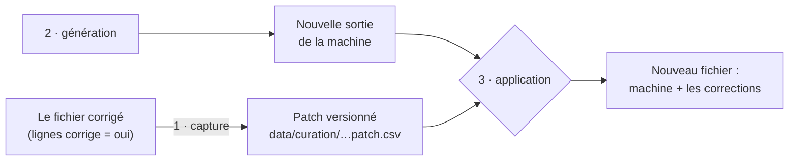

# Guide de la curation : corriger sans jamais perdre ses corrections

Ce guide s'adresse à toute personne qui corrige à la main les résultats de
la chaîne de traitement. Aucune connaissance du code n'est nécessaire. Le
détail technique est dans [`pipeline.md`](pipeline.md#corrections-humaines-rejouables--numrevcurationpy)
et dans `numrev/curation.py`.

## Pourquoi des corrections « rejouables »

La chaîne transforme un annuaire scanné en données, étape par étape. Les
machines (OCR, CRF, modèle NER) se trompent parfois. On corrige donc leurs
résultats à la main.

Mais les machines s'améliorent : un meilleur CRF, un nouveau modèle NER…
On veut alors **relancer la chaîne** pour profiter des progrès sur tout ce
qu'on n'a pas encore relu, **sans perdre une seule correction** déjà faite.
(Refaire l'OCR est un cas à part : voir [Après un nouvel OCR](#après-un-nouvel-ocr).)

Le principe tient en une phrase :

> **On corrige directement le fichier produit, on marque la ligne
> `corrige = oui`, et la commande s'en souviendra à chaque relance.**

## Les trois colonnes à connaître

Chaque fichier qu'on peut corriger contient, en plus de ses données, trois
colonnes spéciales :

| Colonne | À quoi elle sert | Faut-il y toucher ? |
|---|---|---|
| la **clé** (`cle` pour les lignes, `uuid` pour les entrées) | L'identifiant de la ligne : c'est par elle que la commande retrouve la ligne à corriger. Elle vient du texte lu par l'OCR, pas de la page ni de la position : elle ne change pas d'une relance à l'autre, tant que l'OCR n'est pas refait. | **Non**, jamais. |
| `corrige` | La signature du relecteur : `oui` veut dire « un humain a vérifié cette ligne, la machine ne doit plus la changer ». | **Oui** : c'est la seule chose à ne pas oublier. |
| `empreinte` | Un code calculé par la machine à partir des valeurs qu'elle a écrites. Il sert à repérer une ligne modifiée qu'on aurait oublié de signer. | **Non**, jamais. |

Mettre `corrige = oui` sert aussi quand on **valide une ligne sans la
modifier** : confirmer que la machine a raison est une décision humaine
qu'on veut garder.

## Ce qui se passe quand on relance une commande



1. **Capture.** La commande relit le fichier corrigé et recopie toutes les lignes
   `corrige = oui` dans un petit fichier à part, le **patch**, rangé dans
   `data/curation/` et suivi par git.
2. **Génération.** La machine refait son travail.
3. **Application.** Les corrections sont reposées par-dessus. **Le patch
   gagne toujours** sur la machine.

La commande **réussit entièrement ou n'écrit rien**. Si une correction ne
peut pas être réappliquée, ou si une ligne a changé sans être signée, elle
s'arrête et explique pourquoi (voir
[Quand la commande s'arrête](#quand-la-commande-sarrête)).

## Corriger les lignes (étape 3)

**Fichier :** `annuaires/<volume>/<plage>/<…>.lines.csv`
**Commande à relancer :** `uv run numrev tabulate annuaires/<volume>/<plage> --apply` (sans `--apply` : simulation, qui montre les conflits sans rien écrire)
**Patch :** `data/curation/<volume>.<plage>.lines.patch.csv`

On y corrige deux colonnes : `classe` (le type de ligne : `B-ENTRY`,
`I-ENTRY`, `SUB-ENTRY`, `B-TITLE`, `I-TITLE`, `OUT OF SCOPE`, ou
`SUPPRIMÉE`) et `markdown` (le texte, y compris les `#` qui donnent le niveau
d'un titre). Quand utiliser chaque classe, et quel niveau donner à un titre :
[guide d'annotation des lignes](guide_annotation_lignes.md). Les lignes que
l'annotateur a laissées incertaines (`¯\_(ツ)_/¯`) sont à trancher ici.

La classe s'écrit exactement comme ci-dessus (majuscules, tirets, accent) :
une classe vide ou mal écrite sur une ligne corrigée arrête la commande.

**Par où commencer :** filtrer la colonne `douteuse` sur `oui`. Elle signale les
lignes dont au moins un mot a été lu avec une confiance OCR faible (le plus
faible score de la ligne est dans `confiance` : trier dessus pour voir les
pires d'abord). Ces deux colonnes ne se corrigent pas : elles décrivent la
lecture de la machine, et gardent leur valeur après une correction du texte.

Dans les exemples qui suivent, on ne montre que les colonnes utiles.

### Changer une classe

La machine a pris une suite de ligne pour une nouvelle entrée :

| cle | markdown | classe | corrige |
|---|---|---|---|
| `a1f…` | `Badet, rue Helvétius, 37.` | `B-ENTRY` | |
| `c7e…` | `et cartier` | ~~`B-ENTRY`~~ → **`I-ENTRY`** | **`oui`** |

### Corriger un texte ou un niveau de titre

| cle | markdown | classe | corrige |
|---|---|---|---|
| `05b…` | ~~`#### PAPETIERS.`~~ → **`## PAPETIERS.`** | `B-TITLE` | **`oui`** |

### Valider sans rien changer

La ligne est juste, mais on veut la protéger d'un futur CRF qui se
tromperait :

| cle | markdown | classe | corrige |
|---|---|---|---|
| `9d2…` | `Auzou, rue de la Verrerie, 101.` | `B-ENTRY` | **`oui`** |

### Supprimer une ligne

**On n'efface jamais une ligne du fichier.** On lui donne la classe
`SUPPRIMÉE` (avec l'accent) : elle reste visible, mais l'étape suivante
l'ignore.

| cle | markdown | classe | corrige |
|---|---|---|---|
| `3b8…` | `218` (numéro de page en double) | **`SUPPRIMÉE`** | **`oui`** |

C'est ainsi qu'on retire, par exemple, des pages scannées deux fois.

### Ajouter une ligne

On insère une ligne à l'endroit voulu et on **laisse sa clé vide**. Au
prochain lancement, la commande lui donne une clé dérivée de la ligne
précédente (`a1f…+1`) et retiendra sa place. Tout en haut du fichier, avant
la première ligne, elle reçoit la clé `debut+1` : c'est ainsi qu'on restitue
le titre d'une rubrique commencée avant la plage (voir le
[guide d'annotation des lignes](guide_annotation_lignes.md#une-plage-qui-commence-au-milieu-dune-rubrique)).
Une ligne ajoutée n'a ni `confiance` ni `douteuse` : elle n'a pas été lue par
l'OCR.

| cle | markdown | classe | corrige |
|---|---|---|---|
| `9d2…` | `Auzou, rue de la Verrerie, 101.` | `B-ENTRY` | |
| *(vide)* → `9d2…+1` | **`Auzou fils, rue d'Anjou, 21.`** | **`B-ENTRY`** | *(mis à `oui` automatiquement)* |

### Couper une ligne en deux (dupliquer)

Une ligne contient deux entrées collées par l'OCR ? On copie la ligne
juste en dessous (la copie a donc la même clé), puis on répartit le texte :

| cle | markdown | classe | corrige |
|---|---|---|---|
| `e40…` | ~~`Boulanger, rue St.-Benoit, 19. Boulanger (Ve.), rue Vivienne, 22.`~~ → **`Boulanger, rue St.-Benoit, 19.`** | `B-ENTRY` | **`oui`** |
| `e40…` → `e40…+1` | **`Boulanger (Ve.), rue Vivienne, 22.`** | `B-ENTRY` | *(automatique)* |

La commande repère la clé en double et en donne une nouvelle à la copie.

### Déplacer une ligne (ordre de lecture)

L'OCR lit parfois deux colonnes dans le mauvais ordre. **On ne coupe-colle
pas** une ligne : l'ordre des lignes de la machine est celui de l'OCR et doit
le rester. On fait en deux gestes :

1. l'originale reçoit la classe `SUPPRIMÉE` (et `corrige = oui`) ;
2. on insère une copie à la bonne place et on **vide sa colonne `cle`**
   (une copie qui garderait la clé de l'originale serait prise pour la
   ligne machine elle-même, déplacée).

| cle | markdown | classe | corrige |
|---|---|---|---|
| `05b…` | `## PAPETIERS.` | **`SUPPRIMÉE`** | **`oui`** |
| … | *(le bloc qui devait venir avant)* | … | |
| *(vide)* | `## PAPETIERS.` | `B-TITLE` | |

Pour un bloc entier, on fait de même ligne par ligne : toutes les
originales en `SUPPRIMÉE`, toutes les copies sans clé.

## Corriger le NER et les rubriques (étape 5)

**Fichier :** `annuaires/<volume>/<plage>/<…>.ner.csv`
**Commande à relancer :** `uv run numrev tag annuaires/<volume>/<plage> --apply`
**Patch :** `data/curation/<volume>.<plage>.ner.patch.csv`

Chaque ligne du fichier est une **entrée** (ou un titre). On y corrige
deux colonnes :

- `tagged_text` : le découpage en `SUBJ` (qui ?), `DESC` (quoi ?) et `ADDR`
  (où ?), selon le [guide d'annotation](guide_annotation_ner.md) ;
- `parent_uuid` : l'`uuid` du titre de la rubrique à laquelle l'entrée
  appartient.

### Corriger un découpage

| uuid | markdown | tagged_text | corrige |
|---|---|---|---|
| `7c1…` | `Badet, *et cartier*, rue Helvétius, 37.` | ~~`<SUBJ>Badet, *et cartier*</SUBJ>, <ADDR>rue Helvétius, 37.</ADDR>`~~ → **`<SUBJ>Badet</SUBJ>, <DESC>*et cartier*</DESC>, <ADDR>rue Helvétius, 37.</ADDR>`** | **`oui`** |

Seules les balises changent : le texte entre les balises doit rester
exactement celui de la colonne `markdown`. Une faute dans le texte se corrige
dans la table des lignes (étape 3), puis on relance `numrev assemble` et
`numrev tag`. C'est pourquoi on termine la curation des lignes d'une plage
avant d'en relire le NER : corriger ensuite le texte d'une entrée oblige à
refaire sa correction NER.

### Rattacher une entrée à une autre rubrique

On remplace son `parent_uuid` par l'`uuid` de la bonne ligne de titre
(colonne `uuid` d'une ligne `TITLE` du même fichier) :

| uuid | entity | markdown | parent_uuid | corrige |
|---|---|---|---|---|
| `2aa…` | `TITLE` | `## PAPETIERS.` | … | |
| `7c1…` | `ENTRY` | `Badet, …` | ~~`91f…`~~ → **`2aa…`** | **`oui`** |

Les nombres d'empans (`subject_count`…) sont recalculés automatiquement
sur les lignes corrigées.

## Corriger l'alignement entre éditions (étape 7)

Ici on ne corrige pas un gros fichier : on écrit directement les décisions
dans les patchs `data/alignment/<A>__<B>.patch.csv` (entrées) et
`.sections.csv` (rubriques), en s'aidant des boutons « copier » du viewer
(`numrev view alignment`). Les conventions sont dans le
[guide de relecture de l'alignement](guide_relecture_alignement.md).

Les règles sont les mêmes qu'ailleurs : le patch gagne sur la machine, et
la commande s'arrête si une ligne du patch ne correspond plus à rien.

## Quand la commande s'arrête

La commande affiche `✋ Arrêt, rien n'a été écrit`, la liste des lignes en
cause et ce qu'on peut faire. **Rien n'est perdu** : ni le fichier corrigé ni le patch
n'ont été modifiés.

| Message | Ce qui s'est passé | Que faire |
|---|---|---|
| `modifiée sans « corrige = oui »` | Une ligne a été changée sans être signée, ou le tableur l'a modifiée tout seul (une date, un nombre reformaté). | Si c'est une correction voulue : mettre `corrige = oui` et relancer. Si c'est une erreur : relancer avec `--force`. |
| `absente du fichier édité` | Une ligne de la nouvelle sortie n'est pas dans le fichier corrigé : elle a été effacée, ou elle est nouvelle (OCR refait, voir [Après un nouvel OCR](#après-un-nouvel-ocr)). | La remettre et lui donner la classe `SUPPRIMÉE`, ou relancer avec `--force` pour qu'elle revienne. |
| `ligne déplacée` | Une ligne de la machine a changé de place (coupé-collé, ou **tri** du tableau). | Annuler le tri ou le coupé-collé ; pour un vrai déplacement, voir [Déplacer une ligne](#déplacer-une-ligne-ordre-de-lecture). |
| `classe inconnue` ou `classe vide` | (lignes) Une ligne corrigée porte une classe mal écrite (`b-entry`, `B-ENTRY.`) ou pas de classe. | Écrire la classe exactement comme dans la liste affichée, puis relancer. |
| `introuvable dans la nouvelle sortie` | La ligne corrigée n'existe plus : l'OCR a changé son texte, ou l'entrée a été redécoupée en amont. | Refaire la correction sur la nouvelle ligne, puis relancer avec `--force` pour abandonner l'ancienne. |
| `ligne ajoutée après …, introuvable` | (lignes) La ligne qui précédait une ligne ajoutée à la main n'existe plus (OCR refait). | Relancer avec `--force` (la ligne ajoutée est abandonnée), puis l'ajouter de nouveau à sa place. |
| `balisage invalide` | (NER) Une balise de `tagged_text` est mal écrite ou mal fermée (`<SUBJ>Dupont</SUB>`). | Corriger les balises, puis relancer. |
| `texte de l'entité modifié en amont` | (NER) Le texte de l'entrée a changé depuis la correction, qui ne s'y applique plus. | Relancer avec `--force`, puis corriger de nouveau l'entrée. |
| `titre parent … introuvable` | (NER) La rubrique choisie a disparu. | Choisir une autre rubrique, ou `--force`. |
| `colonne(s) absente(s)` | Le fichier a été enregistré dans un autre format (souvent le séparateur `;` au lieu de `,`). | Réenregistrer en CSV avec des virgules, en UTF-8. |
| `ligne orpheline du patch` | (alignement) Une entrée du patch n'existe plus dans les volumes. | Corriger la ligne du patch à la main, ou `--force` pour l'ignorer. |

## Après un nouvel OCR

Les clés des lignes viennent du texte lu par l'OCR. Refaire l'OCR d'une
plage (nouveau modèle, PDF remplacé) change le texte de nombreuses lignes,
donc leurs clés : les corrections de ces lignes ne s'appliquent plus, et les
entrées concernées changent d'`uuid`.

1. Relancer `numrev tabulate` **sans** `--apply` : la commande s'arrête et
   liste les corrections `introuvable dans la nouvelle sortie` et les lignes
   nouvelles (`absente du fichier édité`).
2. Relancer avec `--force --apply` : les corrections dont la ligne a gardé
   son texte sont réappliquées, les autres sont abandonnées et listées
   (l'ancien patch reste dans l'historique git, pour s'en inspirer).
3. Refaire les corrections perdues, puis faire de même aux étapes
   suivantes (`numrev tag`, puis les patchs d'alignement, dont les lignes
   sont rattachées de nouveau à leur entrée, retrouvée par son texte, quand
   c'est possible).

## Forcer, annuler, repartir du patch

- **`--force`** : passer outre un arrêt. Les lignes en cause reprennent la
  nouvelle sortie de la machine, et les corrections
  qui ne s'appliquent plus sont retirées du patch. La commande liste tout ce
  qu'elle a abandonné.
- **Annuler une correction** : vider `corrige` sur la ligne, puis relancer
  avec `--force` ; la machine reprend la main sur cette ligne.
- **`--no-capture`** : ne pas lire le fichier corrigé, repartir du patch. Utile
  après avoir récupéré les corrections de quelqu'un d'autre avec `git pull` :
  sinon, l'ancien fichier local écraserait le patch tout juste reçu.

## Où sont gardées les corrections, et comment les sauvegarder

Les fichiers de `annuaires/` ne sont **pas** suivis par git : ce sont des
fichiers de travail. Les décisions humaines, elles, sont recopiées dans les patchs
de `data/curation/` et `data/alignment/`, qui **sont** suivis par git.

Pour sauvegarder son travail : relancer la commande de l'étape (la capture
met le patch à jour), puis commiter le patch, à part du code :

```bash
git add data/curation/
git commit -m "données: curation des lignes de 1808, pages 100 à 120"
```

Une correction retirée par erreur se retrouve avec `git diff` ou
`git log -p data/curation/`.

## Conseils pour le tableur

- **Filtrer, oui ; trier, non.** Un tri change l'ordre des lignes et fait
  s'arrêter la commande (`ligne déplacée`). Pour trier le temps d'une
  relecture, ajouter d'abord une colonne de numéros 1, 2, 3… et trier de
  nouveau dessus avant d'enregistrer (un tri sur `uid` ne suffit pas : `111.10.0`
  passerait avant `111.2.0`).
- **Filtrer sur `corrige`** montre tout ce qui a déjà été relu.
- **Ne jamais toucher** à `cle`, `uuid` ni `empreinte`.
- **Enregistrer en CSV UTF-8, séparateur virgule.** Excel en français
  enregistre souvent avec des `;` : préférer LibreOffice Calc ou OpenRefine,
  ou vérifier le séparateur. Au pire, la commande s'arrête (`colonne(s)
  absente(s)`) sans rien abîmer.
- **Attention aux conversions automatiques** (« 1.10 » transformé en date,
  zéros supprimés) : si le tableur modifie une ligne sans qu'on le voie, la
  commande s'en aperçoit grâce à l'empreinte et s'arrête.
- Écrire `oui` en toutes lettres dans `corrige` (`Oui` et `OUI`
  conviennent aussi).

## En résumé

1. Corriger directement le fichier produit.
2. Mettre `corrige = oui` sur chaque ligne corrigée ou validée.
3. Ne pas supprimer : `SUPPRIMÉE`. Ne pas déplacer : `SUPPRIMÉE` + copie
   sans clé.
4. Relancer la commande : les corrections sont capturées, puis réappliquées.
5. Si la commande s'arrête, lire le message : rien n'est perdu.
6. Commiter les patchs de `data/`.
